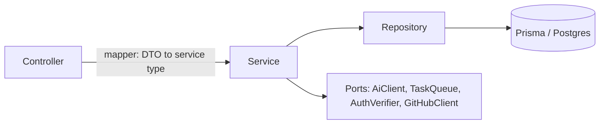

# Backend conventions (NestJS, `apps/api`)

## 1. Stack

- NestJS latest major on **Fastify** (`@nestjs/platform-fastify`). Node 24 LTS.
- Zod (v4) and `nestjs-zod` for every request and response body. Zod schemas are shared with the web app, so one schema validates the form, the request, and the response.
- `nestjs-pino` for logging, `@nestjs/terminus` for health, `@nestjs/swagger` for OpenAPI, `@fastify/helmet`.
- Postgres with pgvector, through **Prisma** and Prisma Migrate.
- Not used: message brokers, Redis, feature-flag services, OpenTelemetry. Cloud Tasks covers async work, and a free-tier personal tool does not need the rest.

## 2. Folder structure

```
apps/api/
  prisma/
    schema.prisma               # all tables, including AI-owned ones (D1)
    migrations/                 # generated by prisma migrate dev, committed
  src/
    main.ts                     # bootstrap only
    app.module.ts
    app.config.ts               # AppConfig.configure(app): prefix, versioning, pipes, Swagger, Helmet, CORS
    common/
      config/                   # env.validation.ts (Zod schema + EnvironmentVariables type)
      errors/                   # DomainError, ErrorTypes, @ErrorType, DomainExceptionFilter
      logger/                   # nestjs-pino options (redaction, request id)
      decorators/               # @CurrentUser(), @Public()
      guards/                   # cross-cutting guards
      health/                   # terminus controller
      prisma/                   # global PrismaModule, PrismaService, Prisma error mapping
      utils/
    integrations/               # outbound adapters, one folder each
      ai/                       # wraps the generated @matchbox/ai-client
      github/
      firebase/
      task-queue/               # TaskQueue port + cloud-tasks and local implementations
    <feature>/                  # applications, jobs, companies, career-items, cv, discover, plans, statuses, users, events
      <feature>.module.ts
      <feature>.controller.ts
      <feature>.service.ts
      <feature>.repository.ts   # abstract class: the port and DI token
      prisma-<feature>.repository.ts  # Prisma implementation
      <feature>.mapper.ts       # DTO <-> service type, used by the controller only
      <feature>.errors.ts
      <feature>.constants.ts
      dto/
        <feature>.dto.ts        # Zod schemas + createZodDto classes
      types/
        <feature>.types.ts      # service/domain types, no Dto suffix
      <feature>.service.spec.ts
  test/
    helpers/                    # TestHelper, withCommons, Mockery, builders
    <feature>/<feature>.e2e-spec.ts
```

Rules:

- A feature folder is a Nest module. It exports only what other modules need, usually its service.
- When a feature grows past roughly eight files, split it into `controllers/` and `services/` subfolders.
- `src/ai-client/` and `src/tasks/` from the M0 scaffold move under `src/integrations/` when they get code.

## 3. Layering



| Layer | May import | Must not |
| --- | --- | --- |
| Controller | DTOs, mapper, its service, decorators | Repositories, Prisma, integrations |
| Mapper | DTO types and service types | Anything with side effects |
| Service | Service types, abstract repositories, ports, other services | DTOs, `dto/` folder, `PrismaService`, `@prisma/client` types, `ConfigService` for business values (inject a typed config provider instead) |
| Repository implementation | `PrismaService`, `@prisma/client` types, service types | HTTP, other features' repositories |
| Integration adapter | Its SDK or HTTP client, config | Repositories, services |

- Controllers are thin: parse, map, call one service method, map the result back.
- Services contain business rules: plan limits, evidence checks, status transitions.
- **Every repository method takes `userId`** and filters by it. User scoping is never left to the caller (HLD section 9, security).
- The DTO boundary is enforced by an ESLint `no-restricted-imports` rule on `**/dto/**` outside controllers and mappers.
- Repositories and the ports that the HLD requires to be swappable are **abstract classes**, used as both the type and the DI token. Services depend on the abstract class; the module binds the implementation. The ports are `AuthVerifier` (F1), `TaskQueue` (D4), `AiClient` (D6), and `GitHubClient`.

```typescript
// integrations/task-queue/task-queue.port.ts
export abstract class TaskQueue {
    abstract enqueue(task: QueuedTask): Promise<void>;
}

// integrations/task-queue/task-queue.module.ts
@Module({
    providers: [
        {
            provide: TaskQueue,
            inject: [ConfigService],
            useFactory: (config: ConfigService<EnvironmentVariables, true>) =>
                config.get('TASK_QUEUE_BACKEND', { infer: true }) === 'cloud-tasks'
                    ? new CloudTasksQueue(config)
                    : new LocalTaskQueue(config),
        },
    ],
    exports: [TaskQueue],
})
export class TaskQueueModule {}

// discover/discover.service.ts
constructor(private readonly taskQueue: TaskQueue) {}
```

## 4. DTOs and contracts

- Request and response schemas that the web app also needs live in `@matchbox/shared` (`packages/shared/src/schemas/`). The API wraps them with `createZodDto`; the web app uses `z.infer` and the same schema for form validation.
- Schemas: `PascalCaseSchema`. DTO classes: `<Action><Resource>RequestDto`, `<Resource>ResponseDto`.
- Service types (in `types/`) have no `Dto` suffix: `CreateApplicationInput`, `Application`.
- Global `ZodValidationPipe` (`APP_PIPE`) and `ZodSerializerInterceptor` (`APP_INTERCEPTOR`). Every handler that returns data declares its response DTO, so the output is validated and stripped of unknown fields.

```typescript
// dto/applications.dto.ts
export class CreateApplicationRequestDto extends createZodDto(CreateApplicationSchema) {}
export class ApplicationResponseDto extends createZodDto(ApplicationSchema) {}

// applications.controller.ts
@ApiTags('applications')
@ApiBearerAuth()
@Controller({ version: '1', path: 'applications' })
export class ApplicationsController {
    constructor(private readonly applicationsService: ApplicationsService) {}

    @Post()
    @ZodSerializerDto(ApplicationResponseDto)
    async create(@CurrentUser() user: AuthUser, @Body() body: CreateApplicationRequestDto) {
        const application = await this.applicationsService.create(user.id, toCreateApplicationInput(body));
        return toApplicationResponse(application);
    }
}
```

## 5. Configuration

- One Zod schema for all env vars in `common/config/env.validation.ts`, passed to `ConfigModule.forRoot({ isGlobal: true, validate })`. The app fails to start on invalid config.
- Read config only through `ConfigService<EnvironmentVariables, true>` with `{ infer: true }`. **No `process.env` outside `env.validation.ts`.**
- Env names are `SCREAMING_SNAKE_CASE`, documented in the root `.env.example`. Do not invent env vars; add them to the schema and `.env.example` in the same change.
- The database connection is a single `DATABASE_URL`, matching what Neon provides.
- Plan limits (HLD 4.4) are built once in `plans/plans.config.ts` from config and injected as a typed provider, so services never read raw env.

## 6. Errors

- Each feature defines an abstract base error and specific subclasses in `<feature>.errors.ts`, tagged with `@ErrorType`:

```typescript
export abstract class ApplicationError extends DomainError {}

@ErrorType(ErrorTypes.NOT_FOUND)
export class ApplicationNotFoundError extends ApplicationError {
    constructor(applicationId: string) {
        super(`Application ${applicationId} not found`);
    }
}
```

- One global `DomainExceptionFilter` maps error types to HTTP status:

| `ErrorTypes` | HTTP |
| --- | --- |
| `VALIDATION` | 400 |
| `UNAUTHORIZED` | 401 |
| `FORBIDDEN` | 403 |
| `NOT_FOUND` | 404 |
| `CONFLICT` | 409 |
| `LIMIT_EXCEEDED` (plan budget) | 429 |
| `UNAVAILABLE` (AI service down, D6) | 503 |
| untyped | 500 |

- Error response body: `{ statusCode, code, message, requestId }`. `code` is the error class name in `SCREAMING_SNAKE_CASE` (`APPLICATION_NOT_FOUND`). No stack traces or internal ids in responses.
- Integration adapters catch SDK and HTTP errors and throw domain errors (`AiUnavailableError`, `GitHubCommitFailedError`) with the original as `cause`. Raw third-party errors never leave `integrations/`.
- Never swallow an error. If a failure is intentionally tolerated (D6 degraded AI), log it at `warn` and return an explicit degraded result.

## 7. Logging

- `nestjs-pino`, JSON output, `app.useLogger(app.get(Logger))`, `bufferLogs: true`.
- In classes: `private readonly logger = new Logger(ApplicationsService.name);`
- Object first, message second: `this.logger.log({ applicationId, userId }, 'Application created');`
- Levels: `log` for the start or end of significant operations and state changes, `debug` for internals, `warn` for tolerated failures and retries, `error` for failures (pass the error as `err`).
- Every log line carries `requestId`. The API reads `x-request-id` or generates one, returns it in the response header, and forwards it to the AI service (HLD section 9, observability).
- Redact `authorization`, cookies, tokens, and keys. **Never log CV text, career item text, or email bodies.** Log ids and counts instead.
- No `console.*`.

## 8. Persistence

- One `prisma/schema.prisma` holds every table, including the AI-owned ones, because the API owns every migration (D1).
- Naming: PascalCase singular models (`CareerItem`), camelCase fields, snake_case plural tables and columns through `@@map` and `@map` (`career_items`, `created_at`). The HLD's entity names (`career_item`, `job_match`) are the model names; the Python AI service reads the mapped table names.
- Primary keys: `String @id @default(dbgenerated("gen_random_uuid()")) @db.Uuid`. Every mutable table has `createdAt` and `updatedAt`; append-only tables (`event`) have only `createdAt`.
- Status-like values (`decision`, `cv_change.state`) are Prisma enums, mirroring the `as const` lists in `@matchbox/shared`.
- `common/prisma/prisma.service.ts`: `PrismaService extends PrismaClient`, `$connect` in `onModuleInit`, `$disconnect` in `onModuleDestroy`, exported by a global `PrismaModule`.
- Each feature has an abstract repository (`applications.repository.ts`) and a Prisma implementation (`prisma-applications.repository.ts`), bound with `{ provide: ApplicationsRepository, useClass: PrismaApplicationsRepository }`. The implementation maps rows to service types with a private `toEntity()`; Prisma types never leave it.
- Every repository method takes `userId` and puts it in the `where` clause.
- Prisma errors are mapped in `common/prisma/prisma-errors.ts` and thrown as domain errors from repositories: `P2002` (unique violation) becomes a `CONFLICT` error and `P2025` (record not found) a `NOT_FOUND` error.
- Multi-step writes that must be atomic (for example, accepting CV changes and creating the new version, F8) use an interactive `prisma.$transaction` inside the repository method that owns the operation.
- pgvector: the extension and vector columns are created in migrations. Vector columns are declared as `Unsupported("vector(<dims>)")` in the schema, and the few API queries that touch them use `$queryRaw` with tagged templates (never string concatenation). Most vector reads and writes happen in the AI service.
- Migrations: `prisma migrate dev --name <snake_case_description>` locally, which produces `<timestamp>_<description>` folders. Review the generated SQL and commit it. Production runs `prisma migrate deploy` as a CI step before the new revision is deployed, not in the container entrypoint, because with scale-to-zero it would repeat on every cold start. `prisma db push` is never used against a shared database.
- `postinstall: prisma generate`.

## 9. HTTP API style

- Global prefix `api`, URI versioning, default version `1`: `/api/v1/applications`.
- Resources are plural kebab-case nouns: `/applications`, `/career-items`, `/companies`. Actions that are not CRUD are verbs under a resource, as in the HLD: `POST /jobs/:id/save`, `POST /applications/:id/tailor`.
- No response envelope for single resources. Collections return `{ items: [...] }` so pagination fields can be added later without breaking clients.
- Long-running work returns `202` with a task id; the client polls `GET /api/v1/tasks/:id` (D3).
- Health: `GET /health/live` (no checks) and `GET /health/ready` (database ping through terminus `PrismaHealthIndicator`), outside the prefix and unversioned.
- Swagger at `/docs`, disabled in production.

## 10. Auth

- A global guard (`APP_GUARD`) verifies the Firebase ID token through the `AuthVerifier` port and attaches `AuthUser` to the request. Mark open routes with `@Public()`.
- Read the user with `@CurrentUser()`, never from `request` directly.
- Task and scheduler endpoints (`/api/v1/internal/*`) use a separate guard that verifies the Cloud Tasks or Cloud Scheduler OIDC token.

## 11. Outbound HTTP

- `HttpModule.registerAsync` per integration with `baseURL` and **an explicit `timeout`** from config (`AI_TIMEOUT_MS` for the AI service). Interactive AI calls must return within 15 s (HLD section 9).
- Retries only for idempotent calls, with exponential backoff, in the adapter.
- The AI service client is generated from its OpenAPI spec into `@matchbox/ai-client` (D5) and wrapped by `integrations/ai/ai.client.ts`. Features depend on the wrapper's port, not on the generated code.

## 12. Bootstrap

```typescript
async function bootstrap() {
    const app = await NestFactory.create<NestFastifyApplication>(AppModule, new FastifyAdapter(), {
        bufferLogs: true,
    });
    await app.get(AppConfig).configure(app);
    const config = app.get<ConfigService<EnvironmentVariables, true>>(ConfigService);
    await app.listen(config.get('API_PORT', { infer: true }), '0.0.0.0');
}
void bootstrap();
```

`AppConfig.configure` sets the logger, Helmet, CORS (`WEB_ORIGIN`), prefix, versioning, Swagger, and `enableShutdownHooks()`.

## 13. Changes needed in the current scaffold

- Replace `@nestjs/platform-express` with `@nestjs/platform-fastify` and upgrade NestJS to the latest major.
- Move `process.env` reads from `main.ts` into the config schema.
- Replace the single `GET /health` with terminus `live` and `ready`.
- Replace `src/database/entities/` and `src/database/migrations/` with `apps/api/prisma/` and `src/common/prisma/`.
