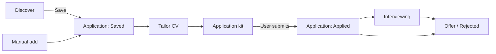
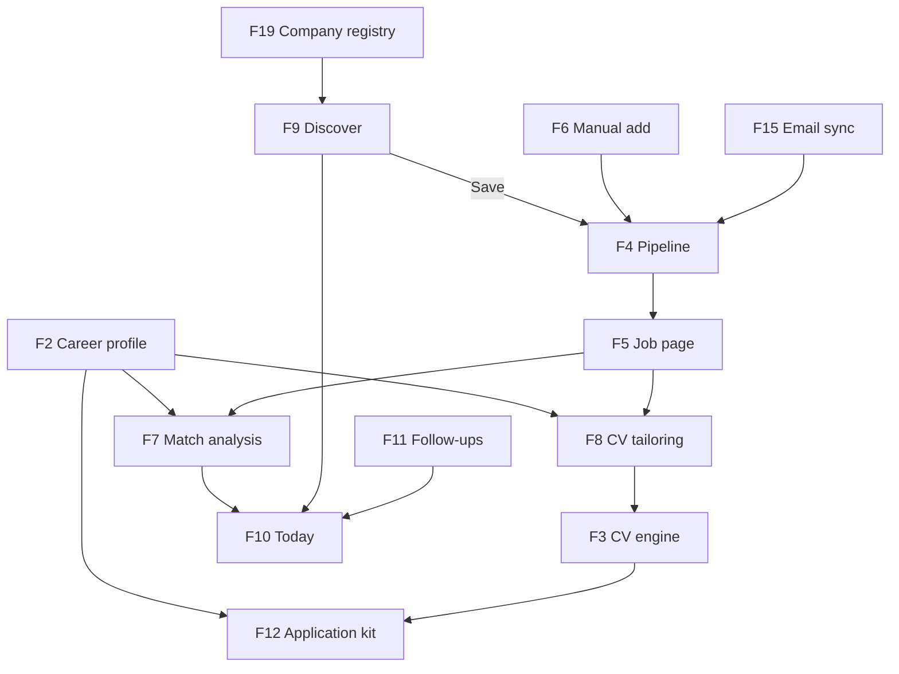
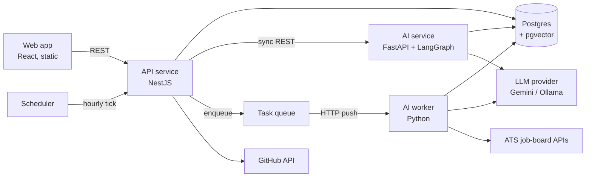
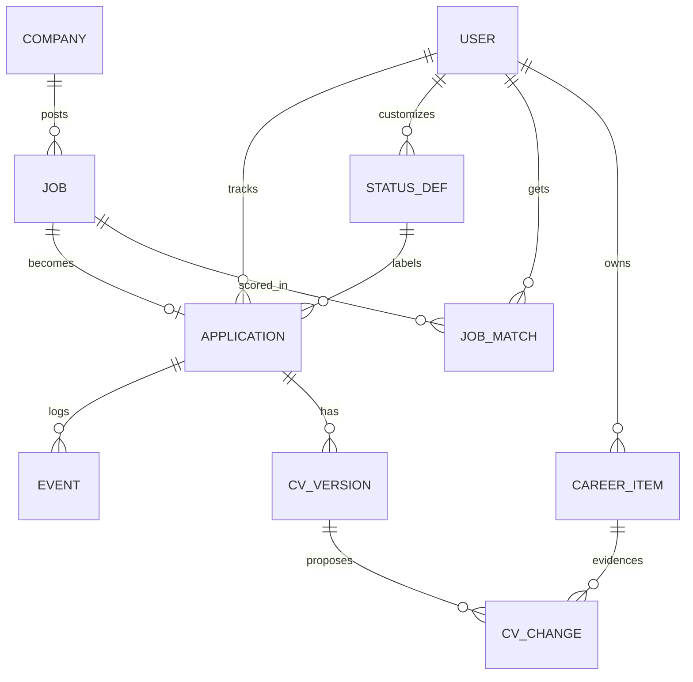
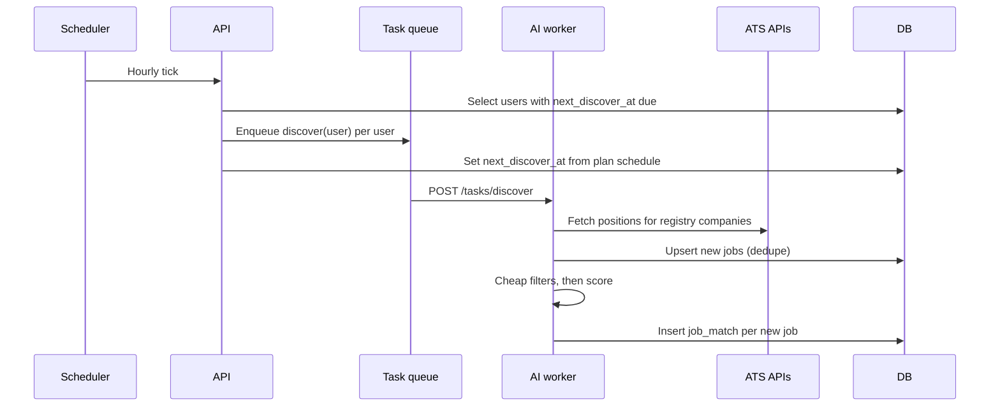

# Matchbox: High-Level Design

**Author:** Dvora Novogrodski **Status:** Draft v0.3 **Date:** October 2026 **Scope:** Product features, system architecture, data model, and the integration points for the AI layer. The internal design of the AI layer (graphs, prompts, retrieval, evals) is covered in a separate document, [Matchbox AI HLD](./ai-hld.md).

---

## 1. Overview

Matchbox is a personal job-search workspace. It helps a job seeker find relevant roles, tailor a CV to each one with verifiable changes, prepare applications quickly, and track every application through to an outcome.

It replaces a prototype, "Applied", built with Lovable. That prototype proved the need: it tracked 23 real applications. But it had three structural problems. Its screens did not share context. CV tailoring was a raw HTML editor. And status tracking depended on manual updates.

### 1.1 Goals

- One central object, the job. Discovery, matching, CV tailoring, applying, and tracking all hang off it.
- A product that is fully usable without AI. AI accelerates the workflow but is never required for it to function.
- AI output that can be verified. Every AI-proposed CV change must point to evidence from the user's own career data, and the user approves each change explicitly.
- Action-oriented UX. The home screen answers "what should I do now?" rather than showing vanity metrics.
- Zero recurring cost: free tiers and self-hostable components only.

### 1.2 Non-goals

- Fully automatic job applications. The user always performs the final submit.
- Scraping sites whose terms forbid it, such as LinkedIn.
- Billing and payments. User plans exist (section 4.4), but only to configure limits.
- Mobile-native apps. The web app is responsive.

---

## 2. Users and core use cases

**Primary user:** an individual job seeker in the Israeli tech market, typically a software engineer, applying to many roles in parallel. In the first phase there is a single user (the author). The design supports more users through plans.

| # | Use case | Frequency |
| --- | --- | --- |
| U1 | See today's to-dos: new matches, CVs to tailor, follow-ups due | Daily |
| U2 | Review jobs found automatically; save or skip | Daily |
| U3 | Add a job manually from a link | Several per week |
| U4 | Understand how well I match a job, and what's missing | Per job |
| U5 | Produce a tailored CV for a job, reviewing each change | Per job |
| U6 | Get an application kit (CV PDF, cover letter, answers) | Per job |
| U7 | Track status, notes, and history per application | Ongoing |
| U8 | Maintain my career profile (experience, projects, skills) | Occasionally |

---

## 3. Core flow

The product is built around a single pipeline. Each stage hands a richer object to the next.



---

## 4. Features

Priority: **P0** is required for the first usable version, **P1** is in scope for the two-week build, **P2** is a stretch goal, and **P3** is a later phase. The AI column marks features that depend on the AI layer. Every P0 feature works without it.

### 4.1 Feature list

| ID | Feature | Priority | AI | Summary |
| --- | --- | --- | --- | --- |
| F1 | Auth | P0 | No | Firebase Authentication: Google sign-in plus email and password, with the app's own login screens |
| F2 | Career profile | P0 | Indexes | Structured experience, projects, skills, and base CV. This is the source of truth for all CV content |
| F3 | CV engine | P0 | No | CV stored as structured JSON, rendered to HTML and PDF from the current template, with versions committed to Git |
| F4 | Pipeline | P0 | No | Board view (default) and table view of applications by status |
| F5 | Job page | P0 | Partly | Hub per job with tabs: Overview, Match, CV, Application kit, Timeline |
| F6 | Manual add and autofill | P0 / P1 | P1 | Add a job by link. Autofill extracts fields from the posting |
| F7 | Match analysis | P1 | Yes | Score, plus requirement-by-requirement coverage with evidence |
| F8 | CV tailoring | P1 | Yes | Proposed changes shown as a diff, each with evidence; accepted or rejected one at a time |
| F9 | Discover | P1 | Yes | Scheduled search across a registry of Israeli tech companies; results scored and queued for review |
| F10 | Today | P1 | Consumes | Prioritized action list built from F4, F7, F9, and F11 |
| F11 | Follow-up reminders | P1 | No | Rules-based: flag applications with no movement for N days |
| F12 | Application kit | P1 | Yes | Cover letter and answers to common questions, plus the CV PDF |
| F13 | Import | P1 | No | One-time CSV import from the Lovable prototype |
| F14 | Settings and integrations | P0 | No | GitHub repo and token, search preferences, custom statuses |
| F19 | Company registry | P1 | Partly | Companies with their ATS and job-board id; add a company by careers URL with automatic ATS detection |
| F15 | Email status sync | P2 | Yes | Classify inbox messages (rejection, interview, task) into timeline events |
| F16 | MCP server | P2 | Exposes | Expose the tracker and CV tools to external AI clients |
| F17 | Browser prefill | P2 | Yes | Prefill application forms from the kit; the user submits |
| F18 | CV templates | P3 | No | Additional CV designs to choose from. Until then, the current HTML design is the single template |

### 4.2 Feature relationships

The career profile is the foundation. Everything AI-related reads from it, and nothing AI-related writes to it without user approval.



### 4.3 Feature details

**F1: Auth.** Identity is handled by Firebase Authentication (no-cost tier). It provides Google sign-in, email and password, and sends verification and password-reset emails from its own domain, so no custom domain or email provider is needed.

- The login and sign-up screens are part of the web app. Firebase is not visible to the user, except as the sender address on account emails.
- The web app signs in with the Firebase client SDK and sends the Firebase ID token with each request.
- The API service verifies the token with the Firebase Admin SDK in a global guard, then loads or creates the matching `user` row by Firebase uid.
- Everything beyond identity stays in Matchbox: the user record, plan, permissions, and data.
- Auth sits behind an `AuthVerifier` interface in the API service, so the provider can be replaced without touching the rest of the code.

**F2: Career profile.** The profile is a set of *career items*. Each item has a kind: experience, project, achievement, skill, or education. Each item holds plain text and metadata such as dates, company, and tech used. The base CV is a curated selection and ordering of these items. Every change to an item triggers re-indexing in the AI layer, which runs asynchronously.

**F3: CV engine.** The CV is a JSON document validated against a schema with these sections: header, summary, experience, projects, skills, and education. A deterministic template renders it to HTML, and a headless browser renders the HTML to PDF. In this phase there is one template, based on the prototype's current design. The renderer takes a template id so that F18 can add templates without changing the CV schema. Saving a version writes `cvs/<yyyy-mm>-<company>-<role>.json` and the rendered `.html` to the user's private GitHub repo as a single commit. The commit SHA is stored on the version.

**F4: Pipeline and the status model.** Statuses come from a fixed system set plus optional custom statuses per user. Every status belongs to a *category*, so that Today, follow-ups, and stats work the same way for custom statuses.

| Category | System statuses |
| --- | --- |
| Open | Saved |
| Active | Applied |
| Interviewing | Screening, Technical, HR |
| Offer | Offer |
| Closed | Rejected, Withdrawn |

A custom status, such as "Home assignment", has a name, a color, a position in the board, and a category. System statuses can be hidden but not deleted.

**F5: Job page.** This is the primary working surface. Each tab maps to a feature:

- **Overview:** posting, company, location, status, recruiter, notes (F6)
- **Match:** F7
- **CV:** F8 and F3
- **Application kit:** F12
- **Timeline:** event log (F11, F15)

The header shows a single primary action that depends on the application's state: *Tailor CV*, then *Prepare to apply*, then *Mark as applied*.

**F8: CV tailoring.** The output is a list of *changes*, never a rewritten document. Each change targets a CV section, carries before and after text, and references the career item that justifies it. A change with no evidence is shown to the user as **blocked** and cannot be accepted. Accepting changes produces a new CV version (F3).

**F9: Discover.** *Sources.* Discover does not crawl the web. It queries the public job-board APIs of applicant tracking systems for the companies in the registry (F19). The initial connectors target the ATS providers common in Israeli tech: Comeet, Greenhouse, Lever, and Ashby, followed by others such as Workable and SmartRecruiters. Companies on systems without a public board API, or with fully custom career sites, are out of scope for automatic discovery and can still be added manually (F6).

*Pipeline.* Each run fetches open positions, deduplicates them against known jobs, applies cheap filters (title, location, exclusions) before any AI call, and scores the remaining new jobs (F7). Results above a threshold appear in Discover and on Today. The user's save and skip decisions are stored and fed back into future runs.

*Schedule.* A single scheduler tick runs every hour. On each tick the API selects users whose next run is due, according to their plan (section 4.4). The default for the owner plan is every 2 hours during the day and every 6 hours at night, in the user's time zone.

**F10: Today.** A read-only aggregation, ordered by priority:

1. New matches to review
2. Saved jobs without a tailored CV
3. Follow-ups due
4. A compact stats strip

Each item has one inline action.

**F19: Company registry.** A shared table of companies with name, careers URL, ATS provider, and board identifier. The registry is seeded from public lists of Israeli tech companies. Adding a company by careers URL triggers ATS detection: the system inspects the page for known ATS embeds and links, and stores the provider and board id when found. Detection is rule-based first, with an AI fallback for pages the rules don't recognize.

### 4.4 Plans and configurable limits

Every user has a plan. A plan is a named set of limits, defined in configuration and overridable by environment variables, so that limits change without a code change.

| Setting | Example (owner plan) |
| --- | --- |
| `discover.dayIntervalHours` | 2 |
| `discover.nightIntervalHours` | 6 |
| `discover.quietHours` | 00:00–07:00 |
| `discover.maxCompanies` | Unlimited |
| `ai.dailyCallBudget` | Set below the provider's free-tier limit |
| `features` | Which P2 features are enabled |

The API checks plan limits before scheduling a run or calling the AI service.

---

## 5. System architecture

### 5.1 Components



| Component | Tech | Responsibility |
| --- | --- | --- |
| Web app | React, TypeScript | All UI, built as static files. Talks only to the API service |
| API service | NestJS, TypeScript | Token verification, domain logic, CRUD, plans, CV rendering, Git commits, owns the DB schema and migrations, orchestrates AI calls |
| AI service | Python, FastAPI, LangGraph | Synchronous AI operations: match analysis, tailoring proposals, autofill extraction |
| AI worker | Python (same codebase as the AI service, separate deployment) | Asynchronous jobs delivered over HTTP: Discover runs, re-indexing, ATS detection, email classification |
| Task queue | Cloud Tasks in production; a local in-memory dispatcher in development | Delivers async jobs to the worker with retries |
| Scheduler | Cloud Scheduler | One hourly tick to the API |
| Database | Postgres with pgvector | All domain data and embeddings |
| LLM provider | Gemini free tier, or Ollama locally | Generation and embeddings, behind a provider interface |
| Identity | Firebase Authentication | Sign-in, Google OAuth, account emails |

### 5.2 Key architectural decisions

**D1: One owner of the schema.** The API service owns all migrations. The AI service reads domain tables directly for retrieval but writes only to AI-owned tables (`career_item_embedding`, `job_match`, `cv_change`) and to job tables during Discover. This keeps one source of truth for the schema while avoiding a chatty API between the services for read-heavy retrieval.

**D2: The API orchestrates; AI services never talk to the web app.** The browser has a single backend. The API service decides when to call AI, applies business rules and plan limits, and persists results. This keeps auth, rate limiting, and validation in one place.

**D3: Sync for interactive, async for long-running.** Match analysis and tailoring are user-triggered and expected in seconds, so they use synchronous REST with a timeout. Discover runs, re-indexing, and ATS detection go through the task queue. The UI polls a job status endpoint.

**D4: Push-based async work.** The worker is an HTTP service that receives tasks, not a process that polls a queue. This lets every service scale to zero on serverless hosting, which is what keeps the system free. The queue sits behind an interface, so it can be swapped for Redis or another broker later.

**D5: Contract-first between TypeScript and Python.** FastAPI generates an OpenAPI spec, and a typed TypeScript client is generated from it for the API service. Changing an AI endpoint without regenerating the client fails CI.

**D6: AI is optional at runtime.** If the AI service is down or over budget, every P0 feature still works. AI-dependent UI shows a clear degraded state, for example "Match analysis unavailable. Try again", instead of failing the page.

**D7: Monorepo.** `apps/web`, `apps/api`, `services/ai`, `packages/shared`, and `infra/`. Each deployable has its own Dockerfile. CI uses path filters so each service builds and deploys independently.

---

## 6. Data model



| Entity | Owner | Notes |
| --- | --- | --- |
| `user` | API | Plan, time zone, `base_cv` (jsonb), `search_prefs` (jsonb), auth identities, encrypted integration tokens, `next_discover_at` |
| `career_item` | API | Profile content. Its embedding lives in an AI-owned table keyed by item id and content hash |
| `company` | API and AI worker | Registry entry: name, careers URL, ATS provider, board id, detection status |
| `job` | API and AI worker | A posting, independent of any application. Unique on `(source, external_id)` or normalized URL |
| `job_match` | AI | Score, per-requirement coverage (jsonb), model version, and the user's decision (pending, saved, skipped) |
| `status_def` | API | System and custom statuses: name, color, position, category, owner (null for system statuses) |
| `application` | API | The user's pursuit of a job: status, dates, recruiter, notes. `status` caches the latest status event |
| `cv_version` | API | CV JSON snapshot, template id, Git path, commit SHA, and whether it is the base CV |
| `cv_change` | AI and API | Proposed edit: section, before, after, evidence item, and state (proposed, accepted, rejected, blocked) |
| `event` | API | Append-only timeline: status changes, notes, emails, follow-ups |

**Separating `job` from `application` is the central modeling decision.** Discover can create many jobs that the user never pursues. An application exists only once the user saves a job.

---

## 7. Key flows

### 7.1 Save a discovered job

```mermaid
sequenceDiagram
  participant U as User
  participant W as Web
  participant A as API
  participant D as DB
  U->>W: Save on a Discover card
  W->>A: POST /jobs/:id/save
  A->>D: Set job_match.decision = saved
  A->>D: Create application (status Saved)
  A->>D: Append event (created)
  A-->>W: Application
  W-->>U: Card leaves Discover; appears in Pipeline and Today
```

### 7.2 Tailor a CV

```mermaid
sequenceDiagram
  participant U as User
  participant A as API
  participant AI as AI service
  participant G as GitHub
  U->>A: POST /applications/:id/tailor
  A->>AI: POST /tailor (job, base CV)
  AI-->>A: Proposed changes with evidence ids
  A->>A: Validate schema and evidence; mark blocked
  A-->>U: Diff view
  U->>A: Accept or reject each change
  U->>A: Save version
  A->>A: Apply accepted changes; render HTML and PDF
  A->>G: Commit JSON and HTML
  A-->>U: Version saved
```

### 7.3 Discover run



---

## 8. AI integration points

This section defines where the AI layer plugs into the product and the contract at each boundary. How each capability works internally belongs in the [Matchbox AI HLD](./ai-hld.md).

| # | Capability | Triggered by | Mode | Input | Output | Human checkpoint | Without AI |
| --- | --- | --- | --- | --- | --- | --- | --- |
| A1 | Profile indexing | Career item create, update, or delete | Async | Career item | Embeddings | None (internal) | Not needed |
| A2 | Posting extraction | Autofill on manual add | Sync | URL or pasted text | Company, role, location, mode, description, requirements | User edits the form before saving | Manual form entry |
| A3 | Match analysis | Job page open (cached), Discover scoring | Sync and async | Job, career items | Score, per-requirement coverage with evidence ids | Informational only | Match tab hidden |
| A4 | CV tailoring | *Tailor CV* on the job page | Sync | Job, base CV, career items | List of changes with evidence ids | Per-change accept or reject | Manual edit of the CV JSON form |
| A5 | Job discovery | Scheduler or manual *Run now* | Async | Search prefs, registry, past decisions | New jobs and their matches | Save or skip per job | Manual add only |
| A6 | Application kit | *Prepare to apply* | Sync | Job, final CV version, profile | Cover letter, answers | User edits before copying | Empty templates |
| A7 | ATS detection fallback | Company added by URL, rules fail | Async | Careers page content | ATS provider and board id | User confirms low-confidence results | Manual entry of provider and id |
| A8 | Email classification (P2) | Inbox sync | Async | Email metadata and body | Event type and linked application | Low-confidence results need confirmation | Manual status updates |

**Rules that apply to every integration point:**

1. All AI outputs are structured, schema-validated responses. Free text is accepted only inside typed fields.
2. Any output that could reach a CV must reference evidence ids. The API service checks that the ids exist and belong to the user.
3. Every AI result is stored with its model id and prompt version, for evals and reproducibility.
4. The AI layer never changes user-owned data directly. Its results become proposals or cached analyses, and the API applies them only after the user acts.
5. Every AI call counts against the user's plan budget (section 4.4).

---

## 9. Non-functional requirements

| Area | Requirement |
| --- | --- |
| Cost | Runs at zero cost on free tiers. AI calls are cached by input hash; a match is recomputed only when the job or the profile changes. Cheap filters run before any AI call. A cloud budget alert guards against surprise charges |
| Privacy | CV and profile data are personal. Provider data-use terms must be checked for free tiers, with a local model option for sensitive operations. The GitHub repo is private |
| Security | Integration tokens are encrypted at rest and used server-side only. All endpoints are scoped to the authenticated user. Worker endpoints accept only authenticated calls from the task queue and scheduler |
| Reliability | AI failures degrade features rather than pages (D6). Async tasks retry with backoff, and their state is visible to the user |
| Performance | Interactive AI calls return within 15 s or show progress; non-AI pages load within 1 s once services are warm. Cold starts are accepted for a personal tool |
| Observability | Structured logs across services with a request id. AI calls are traced (inputs, outputs, tokens, latency) in an LLM observability tool |
| Quality | An offline eval set covers match scoring and tailoring faithfulness, and runs in CI on prompt or model changes |
| Good citizenship | ATS API calls are rate-limited per provider and cached; only public job-board endpoints are used |

---

## 10. Deployment

All hosting fits within free tiers. Google Cloud requires a billing account even for free usage, and a budget alert only notifies; it does not stop spending. The following guardrails are set up before the first deployment:

- Every Cloud Run service runs with `min-instances=0` and `max-instances=1`.
- A budget with a very low threshold publishes to Pub/Sub, and a small function disables billing on the project when the threshold is reached (a hard kill switch).
- Artifact Registry has a cleanup policy that keeps only the latest images.
- Worker and scheduler endpoints reject unauthenticated calls, so outside traffic cannot trigger AI work.

| Piece | Target |
| --- | --- |
| Web app | Static hosting with a free tier (Firebase Hosting, Cloudflare Pages, or similar) |
| API, AI service, AI worker | Separate containers on Cloud Run, scaling to zero |
| Task queue and scheduler | Cloud Tasks and Cloud Scheduler |
| Postgres with pgvector | Managed free-tier Postgres (Neon) |
| Auth | Firebase Authentication, no-cost tier |
| CI/CD | GitHub Actions with path filters; one workflow per deployable |
| Local dev | `docker compose up` runs the full stack, with Ollama as an optional local model |
| Domain | Default platform subdomains for now; a custom domain can be added later |

**Fallback without a credit card.** If GCP turns out to be impractical, the same containers move to a no-card stack: static hosting for the web app, Render's free tier for the API and AI service (accepting sleep and cold starts), Neon for Postgres, and a scheduled GitHub Actions workflow in place of Cloud Scheduler and Cloud Tasks. Docker images, the task-queue interface (D4), and the auth interface (F1) keep this move small.

---

## 11. Milestones

| Phase | Days | Outcome |
| --- | --- | --- |
| M0: Foundations | 1 | Monorepo, compose, CI, health checks, schema v1 |
| M1: Usable without AI | 2–4 | Firebase auth, profile, CV engine with PDF and Git, Pipeline with status model, Job page, import from prototype |
| M2: AI core | 5–9 | A1 indexing, A3 match, A4 tailoring with diff, A2 autofill |
| M3: Discovery | 10–12 | Company registry with ATS detection, A5 Discover with plan-based schedule, Today, follow-ups |
| M4: Polish and proof | 13–14 | A6 kit, evals in CI, observability, deployment, README with architecture |
| Stretch | — | F15 email sync, F16 MCP server, F17 browser prefill |
| Later | — | F18 CV templates |

---

## 12. Decisions log

| # | Question | Decision |
| --- | --- | --- |
| Q1 | Auth provider | Firebase Authentication, chosen because it sends account emails without a custom domain and costs nothing. Kept behind an interface (F1) |
| Q2 | Job sources | Israeli tech market via a company registry and public ATS job-board APIs (F9, F19) |
| Q3 | CV template | Keep the current design as the single template; more templates in P3 (F18) |
| Q4 | Discover cadence | Plan-based schedule; owner default is every 2 hours by day and every 6 hours at night (section 4.4) |
| Q5 | Status model | Fixed system statuses plus custom statuses, each mapped to a category (F4) |
| Q6 | Hosting | GCP free tier (Cloud Run, Cloud Tasks, Cloud Scheduler) with cost guardrails and a hard billing kill switch; Neon for Postgres; static hosting for the web app. A no-card fallback is defined (section 10) |

## 13. Open questions

1. **Registry seed:** which public lists of Israeli tech companies to seed from, and how large the initial registry should be.
2. **ATS coverage:** what share of target companies the first four connectors actually cover. To be measured after the registry is seeded.